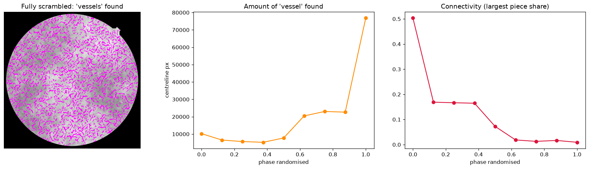

# Structure or Texture?

**Does a vessel segmentation find real anatomy, or just texture that looks like it?**

Most vessel-segmentation methods are judged against hand-drawn maps. Most real images don't have one.
This project builds a check that needs no ground truth: scramble the image so it keeps the same texture
but loses its arrangement, run the identical pipeline, and compare.

## Key result so far (one image)

| | Real retina | Fully scrambled |
|---|---|---|
| Centreline length (px) | 10,230 | 76,842 |
| Connected pieces | 37 | 826 |
| Largest-piece share | **0.503** | **0.009** |

How much "vessel" a method finds is not evidence: it finds 7.5x more in noise.
Connectivity is what separates them (Spearman rho = -0.98 against scramble level).

## Steps

| Step | What it does | Figure |
|---|---|---|
| 01 | Remove the camera aperture rim, which a vessel filter mistakes for a vessel | `figures/01_find_eye.png` |
| 02 | Multi-scale Hessian tube filter; measures that green carries vessels (3.2x red) | `figures/02_vessel_filter.png` |
| 03 | Otsu threshold chosen by the data, not by eye | `figures/03_threshold.png` |
| 04 | Centreline length, branch points, calibre, connectivity to the optic disc | `figures/04_measure.png` |
| 05 | Phase-surrogate dose sweep: same spectrum, structure destroyed | `figures/05_surrogate.png` |

## Run it

~~~
python3 -m venv .venv && source .venv/bin/activate
pip install -r requirements.txt
python step05_surrogate.py
~~~

## Honest limits

- **One image, no ground truth.** Every number here is reproducibility, not accuracy.
- **Pixels, not millimetres.** The image carries no scale.
- **Not a diagnosis.** One photograph with no clinical record says nothing about anyone's health.
- **Low connectivity is ambiguous.** It can mean noise, or real vessels with gaps
  (in step 04 the whole lower arcade is real but disconnected). Separating these is the next step.

## Roadmap

- [x] Steps 01-05 on one image
- [ ] Proper surrogate test (IAAFT, many surrogates) with a per-image p-value
- [ ] Calibrate against hand-drawn maps (DRIVE, STARE, CHASE_DB1)
- [ ] Audit deep-learning vessel models on scrambled images
- [ ] Test a second kind of tubular image

## Credits

Steps 01-05 were inspired by a public post, "5 medical imaging projects you can do at home with Claude".
The retina image ships with [scikit-image](https://scikit-image.org) (`skimage.data.retina()`).
Threshold values differ slightly from the post (0.1756 vs 0.1739), likely from loading the image differently.
